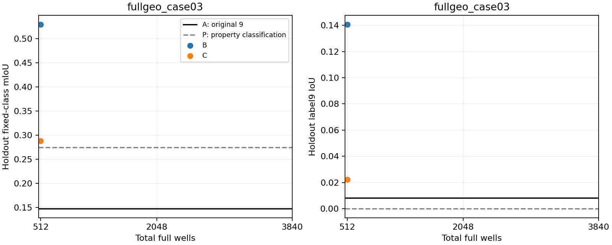
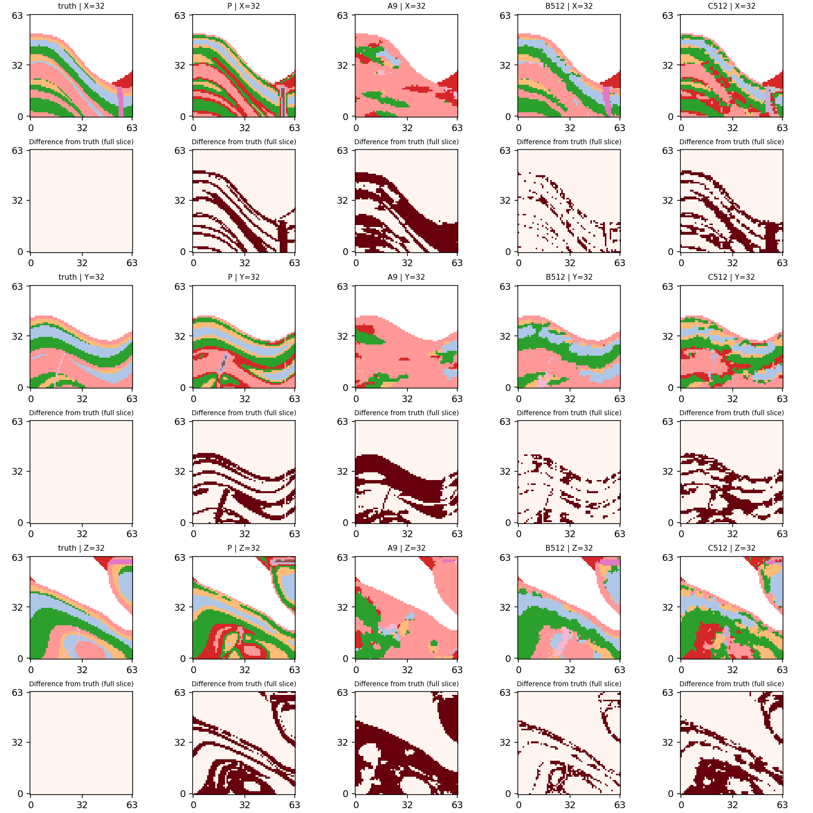
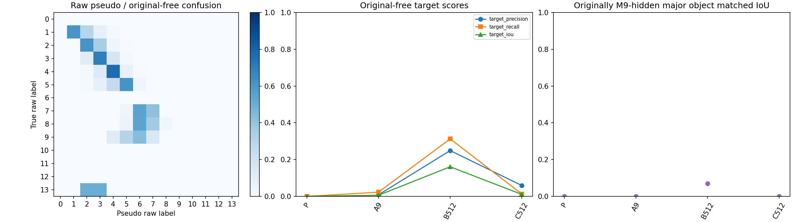
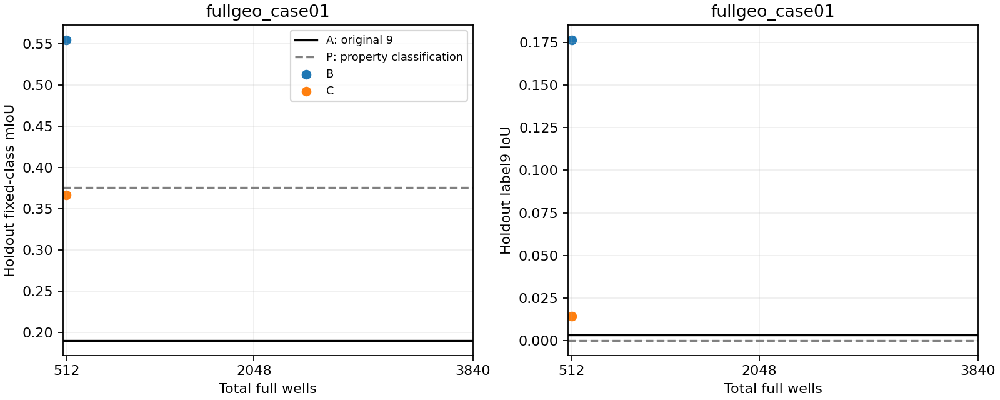
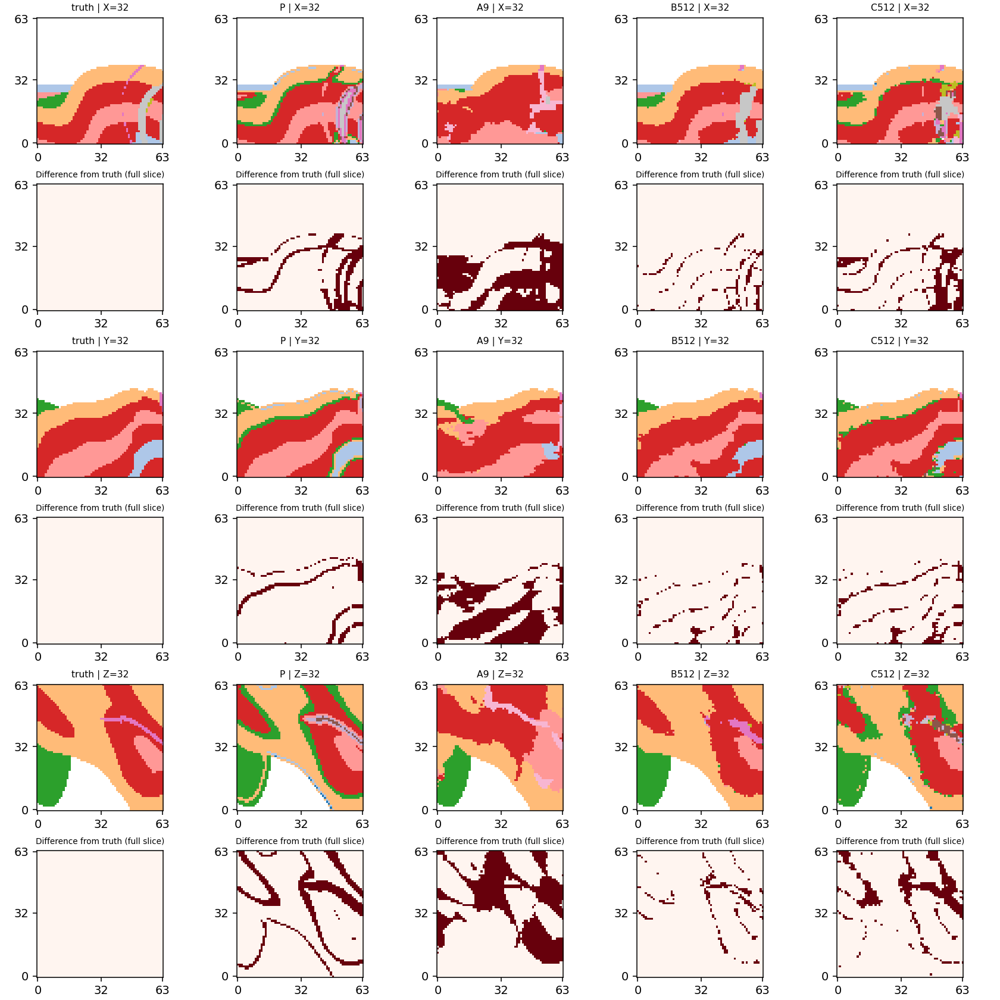
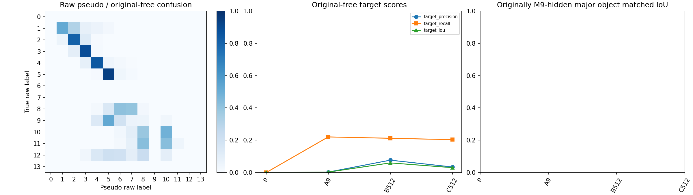
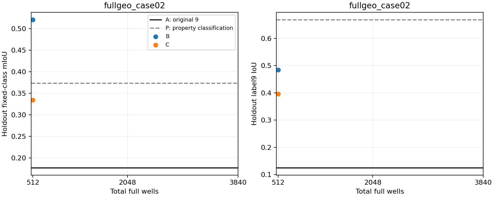
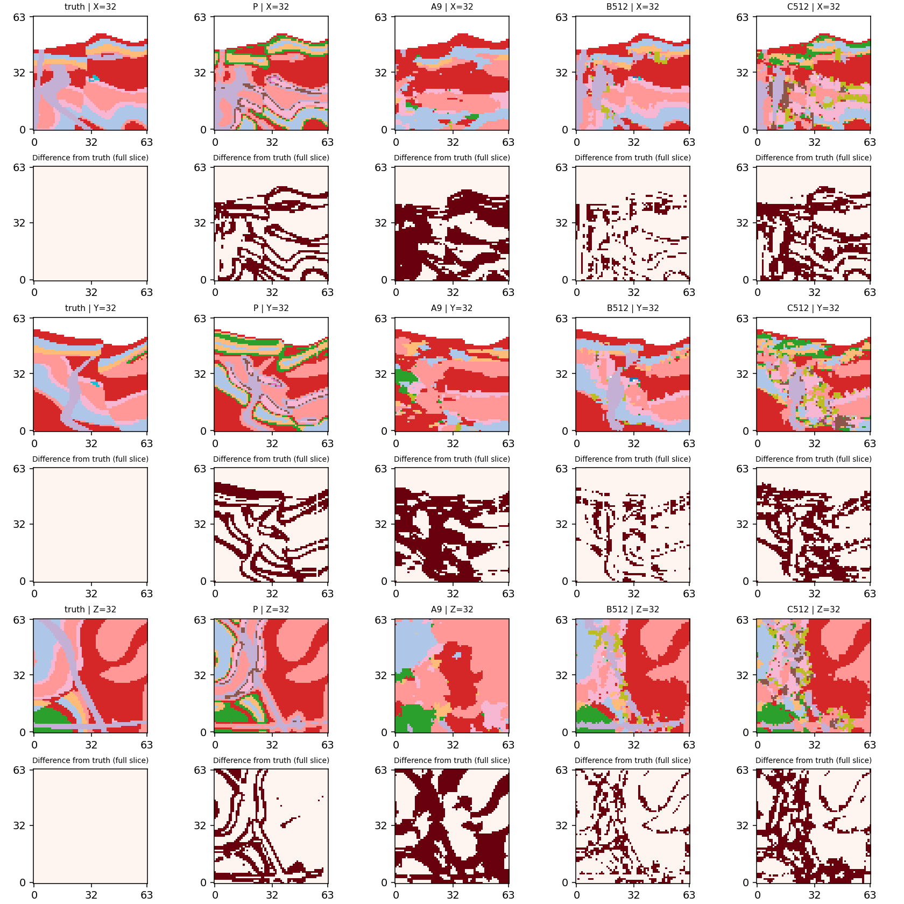
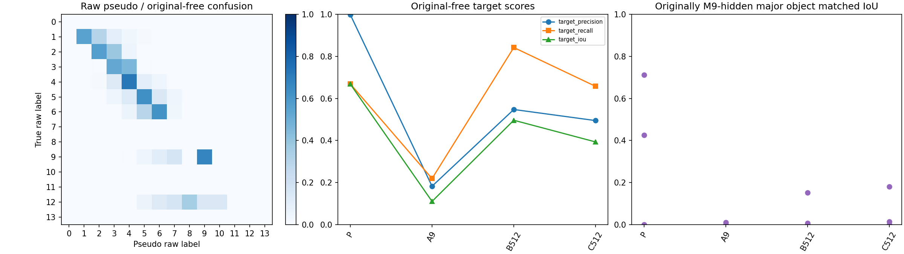

# Stage21v2：密集准确井与同位置伪井

结论：512口准确井已产生明显的固定留出域类别收益；同位置伪井保留部分收益，且超出仅直接写入，但没有获得优于完整属性分类P的一致优势，也未建立可靠隐藏对象恢复。应优先解决伪井漏目标与错误硬条件问题，不直接进入真实正反演或新训练。

case03的3个seed留出域mIoU中位数：A=0.148135、B512=0.520606、C512=0.284274、P=0.274543。C−A逐seed主域差全为正，中位+0.140021；原未知域逐seedmIoU配对差中位+0.122987，label9 IoU配对差中位+0.003241，通过的只是预定描述性确认规则。seed242的原未知域label9 IoU反而下降0.00008167，且主域目标IoU为0；不能宣称所有目标指标稳定改善。

case01/02固定seed42留出域A/B/C/P mIoU分别为0.190461/0.554534/0.367135/0.375864，以及0.177296/0.520625/0.333983/0.373385。两例C均优于A，但mIoU都低于P；case02的留出目标IoU C=0.396172，也低于P=0.668373。因此不能宣称Flow伪井桥整体优于直接属性分类。

case03在sigma1原始分类后，原未知域1733个真值label9体素全部漏失；C各seed仅预测388/165/160个目标体素，目标体积严重不足。其原M9零命中572体素主要对象在N512布局有62个真值体素被井位命中，但C的三个seed对象匹配IoU均为0；准确井B的匹配IoU也仅0.0704–0.0817，尚不满足原诊断阈值。case02对象926体素的C匹配IoU约0.1805，而P约0.7123；类别改善没有转化为一致的对象优势。case02目标体积误差也由A约0.1995增至C约0.3288，须保留这种代价。

上述留出域收益不能由直接写入解释，因为D在该域逐元素等于A；原未知辅助域同时报告C−D以区分硬写入与生成响应。2048/3840均依冻结规则未执行，不能推断其表现。

本轮按冻结协议完成有限顺序诊断。准确井、伪井和直接写入对照共用固定留出柱；评价在每份预测封存后由独立离线程序进行。

新 Flow 输出 10 份，网络前向 320 次；复用旧 N9 基线 5 份；新推理总耗时（含加载）233.98 秒。
首个候选密度：512；三 seed 描述性确认通过：True。未执行配置详见 execution_checklist.csv，不能据此判断更高密度或其他案例。

## 固定域类别结果

P 为完整属性分类（加回原条件），不随 N 变化。A 是原9井；B 是准确井；C 是同位伪井；D 仅将 C 条件写入 A。D 的留出结果逐元素等于 A。

|案例|seed|臂|总井数|holdout mIoU|holdout label9 IoU|original-free mIoU|original-free label9 IoU|original-free P/R|目标预测/真值体积|
|---|---:|---|---:|---:|---:|---:|---:|---|---| 
|fullgeo_case03|—|P|—|0.274543|0.000000|0.248198|0.000000|N/A/0.000000|0/1733|
|fullgeo_case03|42|A|9|0.148135|0.008065|0.119229|0.006382|0.008743/0.023081|4575/1733|
|fullgeo_case03|42|B|512|0.528923|0.140704|0.492050|0.160974|0.249081/0.312752|2176/1733|
|fullgeo_case03|42|D|512|0.148135|0.008065|0.136125|0.006656|0.009467/0.021927|4014/1733|
|fullgeo_case03|42|C|512|0.288156|0.022059|0.242216|0.010963|0.059278/0.013272|388/1733|
|fullgeo_case03|142|A|9|0.133449|0.007874|0.111906|0.003656|0.006289/0.008656|2385/1733|
|fullgeo_case03|142|B|512|0.513675|0.111111|0.492755|0.157736|0.247989/0.302366|2113/1733|
|fullgeo_case03|142|C|512|0.284274|0.017699|0.242758|0.006897|0.078788/0.007501|165/1733|
|fullgeo_case03|142|D|512|0.133449|0.007874|0.129836|0.003940|0.007180/0.008656|2089/1733|
|fullgeo_case03|242|A|9|0.154557|0.002857|0.130044|0.004859|0.007011/0.015580|3851/1733|
|fullgeo_case03|242|B|512|0.520606|0.120192|0.492390|0.168778|0.256376/0.330641|2235/1733|
|fullgeo_case03|242|C|512|0.283027|0.000000|0.243126|0.004777|0.056250/0.005193|160/1733|
|fullgeo_case03|242|D|512|0.154557|0.002857|0.145466|0.004326|0.006520/0.012695|3374/1733|
|fullgeo_case01|—|P|—|0.375864|0.000000|0.367278|0.000000|N/A/0.000000|0/118|
|fullgeo_case01|42|A|9|0.190461|0.003190|0.187488|0.002618|0.002642/0.220339|9840/118|
|fullgeo_case01|42|B|512|0.554534|0.176471|0.559558|0.059524|0.076453/0.211864|327/118|
|fullgeo_case01|42|C|512|0.367135|0.014286|0.366634|0.030227|0.034286/0.203390|700/118|
|fullgeo_case01|42|D|512|0.190461|0.003190|0.205724|0.002963|0.002995/0.220339|8682/118|
|fullgeo_case02|—|P|—|0.373385|0.668373|0.379002|0.668057|0.997862/0.669014|10758/16046|
|fullgeo_case02|42|A|9|0.177296|0.125519|0.175427|0.110751|0.182834/0.219307|19247/16046|
|fullgeo_case02|42|B|512|0.520625|0.484266|0.564899|0.496289|0.547352/0.841767|24677/16046|
|fullgeo_case02|42|C|512|0.333983|0.396172|0.336833|0.393289|0.494700/0.657360|21322/16046|
|fullgeo_case02|42|D|512|0.177296|0.125519|0.194266|0.148476|0.243036/0.276206|18236/16046|

## 准确井、伪井与写入效应

- fullgeo_case03/seed42/B/N512：相对 A 的 holdout mIoU 差 +0.380789；original-free mIoU 差 +0.372821；相对 P 的 holdout mIoU 差 +0.254381。
- fullgeo_case03/seed42/C/N512：相对 A 的 holdout mIoU 差 +0.140021；original-free mIoU 差 +0.122987；相对 P 的 holdout mIoU 差 +0.013613。
- fullgeo_case01/seed42/B/N512：相对 A 的 holdout mIoU 差 +0.364072；original-free mIoU 差 +0.372069；相对 P 的 holdout mIoU 差 +0.178670。
- fullgeo_case01/seed42/C/N512：相对 A 的 holdout mIoU 差 +0.176674；original-free mIoU 差 +0.179146；相对 P 的 holdout mIoU 差 -0.008729。
- fullgeo_case02/seed42/B/N512：相对 A 的 holdout mIoU 差 +0.343329；original-free mIoU 差 +0.389472；相对 P 的 holdout mIoU 差 +0.147240。
- fullgeo_case02/seed42/C/N512：相对 A 的 holdout mIoU 差 +0.156687；original-free mIoU 差 +0.161406；相对 P 的 holdout mIoU 差 -0.039402。

D 在 holdout 与 A 完全相同，因此 B/C 在该域的差异属于重新运行冻结 Flow 后的补全响应；辅助域包括新井，必须结合 D 比较直接写入贡献。井数512及以上超过训练时8–31口井的条件密度。

## 对象与体积

26连通对象 ID 建立于完整体积，再在固定域一对一匹配。major=全体积≥20；重叠边≥5体素且覆盖真值对象≥5%；IoU/coverage≥0.1只作诊断。密集井已命中的对象不能称仍完全隐藏。连续匹配分数、新增命中体素、分裂、合并、未匹配和小碎片见对象表。

|案例|seed|臂|N|原M9零命中主要对象ID|新增井命中体素|original-free匹配IoU|coverage|诊断检测|
|---|---:|---|---:|---:|---:|---:|---:|---|
|fullgeo_case03|N/A|P|N/A|1|0|0.0|0.0|False|
|fullgeo_case03|42|A|9|1|0|0.0|0.0|False|
|fullgeo_case03|42|B|512|1|62|0.07038123167155426|0.08391608391608392|False|
|fullgeo_case03|42|D|512|1|62|0.0|0.0|False|
|fullgeo_case03|42|C|512|1|62|0.0|0.0|False|
|fullgeo_case03|142|A|9|1|0|0.0|0.0|False|
|fullgeo_case03|142|B|512|1|62|0.07384615384615385|0.08391608391608392|False|
|fullgeo_case03|142|C|512|1|62|0.0|0.0|False|
|fullgeo_case03|142|D|512|1|62|0.0|0.0|False|
|fullgeo_case03|242|A|9|1|0|0.0|0.0|False|
|fullgeo_case03|242|B|512|1|62|0.08169014084507042|0.10139860139860139|False|
|fullgeo_case03|242|C|512|1|62|0.0|0.0|False|
|fullgeo_case03|242|D|512|1|62|0.0|0.0|False|
|fullgeo_case02|N/A|P|N/A|3|0|0.0|0.0|False|
|fullgeo_case02|N/A|P|N/A|11|0|0.7122844827586207|0.7138228941684666|True|
|fullgeo_case02|N/A|P|N/A|14|0|0.4263565891472868|0.4263565891472868|True|
|fullgeo_case02|N/A|P|N/A|16|0|0.0|0.0|False|
|fullgeo_case02|42|A|9|3|0|0.0|0.0|False|
|fullgeo_case02|42|A|9|11|0|0.010741138560687433|0.01079913606911447|False|
|fullgeo_case02|42|A|9|14|0|0.0|0.0|False|
|fullgeo_case02|42|A|9|16|0|0.0|0.0|False|
|fullgeo_case02|42|B|512|3|4|0.15217391304347827|0.21875|True|
|fullgeo_case02|42|B|512|11|102|0.0010799136069114472|0.0010799136069114472|False|
|fullgeo_case02|42|B|512|14|24|0.007751937984496124|0.007751937984496124|False|
|fullgeo_case02|42|B|512|16|10|0.0|0.0|False|
|fullgeo_case02|42|C|512|3|4|0.0|0.0|False|
|fullgeo_case02|42|C|512|11|102|0.18045774647887325|0.22138228941684665|True|
|fullgeo_case02|42|C|512|14|24|0.015503875968992248|0.015503875968992248|False|
|fullgeo_case02|42|C|512|16|10|0.0|0.0|False|
|fullgeo_case02|42|D|512|3|4|0.0|0.0|False|
|fullgeo_case02|42|D|512|11|102|0.02795698924731183|0.028077753779697623|False|
|fullgeo_case02|42|D|512|14|24|0.0|0.0|False|
|fullgeo_case02|42|D|512|16|10|0.0|0.0|False|

## 同 seed 配对差 C−A

|seed|holdout mIoU|original-free mIoU|original-free label9 IoU|
|---:|---:|---:|---:|
|42|+0.140021|+0.122987|+0.004581|
|142|+0.150825|+0.130852|+0.003241|
|242|+0.128470|+0.113082|-0.000082|
|配对差中位数|+0.140021|+0.122987|+0.003241|

## 结论边界与下一步

本轮区分了准确井信息效应、平滑属性转岩性的错误和冻结 Flow 对错误硬井的响应。类别收益不自动证明对象恢复；应结合上述对象匹配、目标体积和碎片数据解读。

开发例确认通过，可考虑另行冻结真实正反演替代方案，但跨例、对象/体积和直接分类 P 仍须共同支持；当前结果不等于真实物理桥成功。

码本为人为设定的 density_proxy 与 label9 对比 susceptibility_contrast_proxy，是可分属性上限的受控合成证据，不是校准岩石物理或真实反演。sigma=1、无噪声，无参数扫描；sigma0仅CPU往返且非空气分类无碰撞。所有0…13类别参与分类，固定非空气码本尺度；原硬空气及9井优先。

holdout未作为类别条件输入，但参与合成完整属性平滑；不构成严格独立观测留出。案例历史已使用，预训练重叠未知；三个source seeds不是独立地质样本，不做n=3显著性或泛化声明。4096口端点为直接写入，未运行Flow。未运行训练、微调、adapter、真实正反演、sigma/井位/seed搜索。

## 资产与核验

- PROTOCOL.json / layout.json / classifier.json：冻结规则、全井序及sigma0审计。
- inference_registry.json 与 evaluation_registry.json：准备好的条件与离线评价资产分离；CUDA进程文件防火墙拒绝真值和完整P。
- predictions/*/receipt.json：源代码、条件、CPU噪声、预测和checkpoint哈希、EMA、耗时、前向数及原/新增条件违例。A复用保留原预测指针和复用依据。
- sample_metrics.csv：两固定域、逐类交并/分母/IoU/P/R、准确率及目标体积误差。
- object_metrics.csv / predicted_object_metrics.csv / overlap_matrices：全对象诊断。
- pseudo_well_confusion.csv / confusion：逐档伪井混淆、完整伪体各固定域混淆。
- execution_checklist.csv / execution_state.json：实际执行、跳过原因、配对差与网络预算。
- TEST_RESULTS.json / DELIVERY_AUDIT.json：测试及独立资产核验。

## 补充：完整伪体与直接写入的定量解释

- fullgeo_case03：原未知域原始伪岩性 label9 预测体素 0，真值 1733；precision=N/A（无预测），recall=0.000000，IoU=0.000000。这是固定 sigma1 转换后的损失，不因结果调整码本或尺度。
- fullgeo_case01：原未知域原始伪岩性 label9 预测体素 0，真值 118；precision=N/A（无预测），recall=0.000000，IoU=0.000000。这是固定 sigma1 转换后的损失，不因结果调整码本或尺度。
- fullgeo_case02：原未知域原始伪岩性 label9 预测体素 10758，真值 16046；precision=0.9978620561442647，recall=0.669014，IoU=0.668057。这是固定 sigma1 转换后的损失，不因结果调整码本或尺度。

下表先按同case/seed相减，再对该案例已执行seed取中位；case03为3个seed，case01/02各1个seed。C−D描述超出直接写入的生成响应，C−P比较完整直接属性分类。mIoU与目标IoU的优劣分别解释。

|案例|比较|域|seed数|配对ΔmIoU中位|配对Δlabel9 IoU中位|配对Δ目标recall中位|
|---|---|---|---:|---:|---:|---:|
|fullgeo_case03|C-A|E_holdout|3|+0.140021|+0.009825|+0.000000|
|fullgeo_case03|C-A|E_original_free|3|+0.122987|+0.003241|-0.009810|
|fullgeo_case03|C-D|E_holdout|3|+0.140021|+0.009825|+0.000000|
|fullgeo_case03|C-D|E_original_free|3|+0.106091|+0.002956|-0.007501|
|fullgeo_case03|C-P|E_holdout|3|+0.009731|+0.017699|+0.019417|
|fullgeo_case03|C-P|E_original_free|3|-0.005440|+0.006897|+0.007501|
|fullgeo_case01|C-A|E_holdout|1|+0.176674|+0.011096|-0.090909|
|fullgeo_case01|C-A|E_original_free|1|+0.179146|+0.027609|-0.016949|
|fullgeo_case01|C-D|E_holdout|1|+0.176674|+0.011096|-0.090909|
|fullgeo_case01|C-D|E_original_free|1|+0.160910|+0.027263|-0.016949|
|fullgeo_case01|C-P|E_holdout|1|-0.008729|+0.014286|+0.090909|
|fullgeo_case01|C-P|E_original_free|1|-0.000644|+0.030227|+0.203390|
|fullgeo_case02|C-A|E_holdout|1|+0.156687|+0.270653|+0.451382|
|fullgeo_case02|C-A|E_original_free|1|+0.161406|+0.282538|+0.438053|
|fullgeo_case02|C-D|E_holdout|1|+0.156687|+0.270653|+0.451382|
|fullgeo_case02|C-D|E_original_free|1|+0.142567|+0.244813|+0.381154|
|fullgeo_case02|C-P|E_holdout|1|-0.039402|-0.272201|+0.030706|
|fullgeo_case02|C-P|E_original_free|1|-0.042169|-0.274768|-0.011654|

结构与体积仍需独立核对：

|案例|seed|臂|N|original-free目标体积|绝对相对体积误差|完整目标连通分量|合并数|分裂数|≤5体素碎片数|
|---|---:|---|---:|---:|---:|---:|---:|---:|---:|
|fullgeo_case03|N/A|P|N/A|0|1.0|1|0|0|1|
|fullgeo_case03|42|A|9|4575|1.639930755914599|23|0|0|10|
|fullgeo_case03|42|B|512|2176|0.2556260819388344|40|0|2|22|
|fullgeo_case03|42|D|512|4014|1.3162146566647432|28|0|0|13|
|fullgeo_case03|42|C|512|388|0.7761107905366417|36|0|0|25|
|fullgeo_case03|142|A|9|2385|0.3762261973456434|16|0|0|9|
|fullgeo_case03|142|B|512|2113|0.2192729371032891|32|0|2|20|
|fullgeo_case03|142|C|512|165|0.9047893825735719|37|0|0|29|
|fullgeo_case03|142|D|512|2089|0.20542412002308136|16|0|0|9|
|fullgeo_case03|242|A|9|3851|1.2221581073283323|32|0|0|17|
|fullgeo_case03|242|B|512|2235|0.2896710905943451|31|0|2|15|
|fullgeo_case03|242|C|512|160|0.9076745527986151|32|0|0|26|
|fullgeo_case03|242|D|512|3374|0.9469128678592037|34|0|0|18|
|fullgeo_case01|N/A|P|N/A|0|1.0|1|0|0|1|
|fullgeo_case01|42|A|9|9840|82.38983050847457|16|0|0|7|
|fullgeo_case01|42|B|512|327|1.771186440677966|22|0|0|15|
|fullgeo_case01|42|C|512|700|4.932203389830509|61|0|0|42|
|fullgeo_case01|42|D|512|8682|72.57627118644068|16|0|0|9|
|fullgeo_case02|N/A|P|N/A|10758|0.3295525364576842|16|0|0|4|
|fullgeo_case02|42|A|9|19247|0.19948896921351117|69|1|0|47|
|fullgeo_case02|42|B|512|24677|0.5378910631933193|55|1|0|48|
|fullgeo_case02|42|C|512|21322|0.32880468652623707|97|1|3|79|
|fullgeo_case02|42|D|512|18236|0.13648261248909385|234|1|0|184|

完整伪体的全地下/原未知域逐类指标及对象诊断见 pseudo_volume_metrics.csv、pseudo_volume_objects.csv。混淆矩阵使用原始分类体；P另加回原硬条件。precision分母为0记N/A，recall/IoU在存在真值且无预测时为0，未伪装为分类碰撞。

离线工程记录：补充统计脚本首次因ROOT变量被导入常量遮蔽而定位错误，已改为RUN_ROOT；保留OFFLINE_POSTPROCESS_INITIAL_FAILURE.json。核心推理源码、条件与预测未修改，未增加网络前向。
