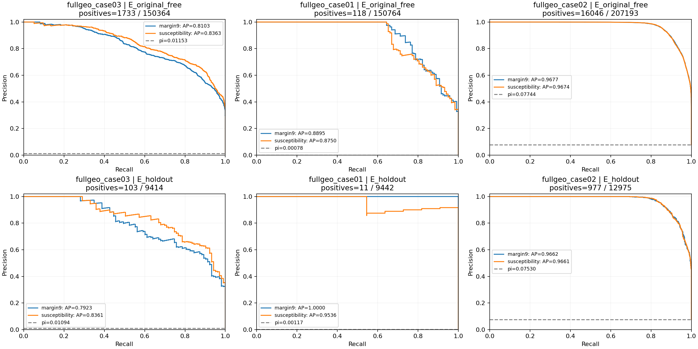
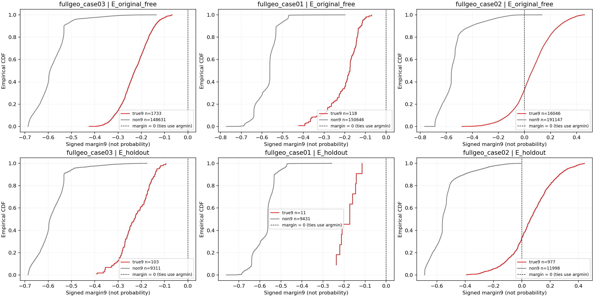
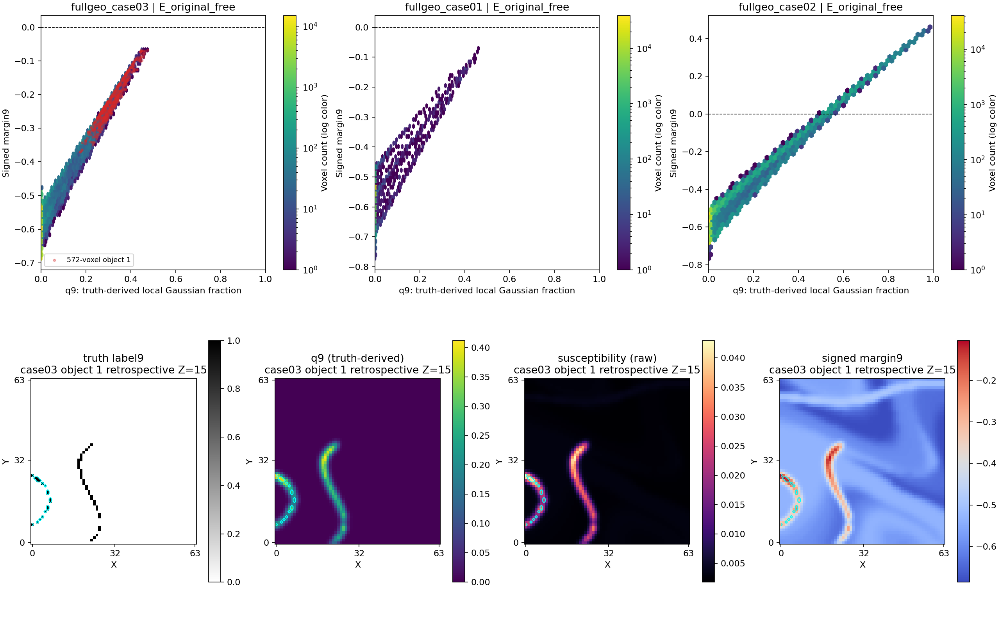

# Stage21v2：连续属性线索与最近码本硬分类的离线诊断

## 结论先读：连续定位线索保留，当前硬标签接口丢失了目标

本轮结果更支持“平滑后的连续属性仍有可读的定位线索，但当前最近纯类别码本的argmin把线索压缩掉”，而非“这两个失败案例已没有容易读取的目标证据”。这只成立于本轮人为强目标对比的属性代理和指定诊断，不是独立物理反演结论，也不保证后续连续条件方法有效。

- **case03，全局与572体素隐藏实例均有线索。** 原未知域pi=0.01152537（约1.153%）；margin AP=0.810281、AP_skill=0.808069，susceptibility AP=0.836303、AP_skill=0.834394，均远高于pi。两种分数的固定top5%各选7519体素，precision=0.230483、recall=1，覆盖全部1733个目标体素。原9井和原硬条件都零命中的对象1（572体素），两分数均覆盖572/572；辅助holdout内也均覆盖25/25。它确实在连续证据中可定位，但原始硬分类为0个目标体素。
- **case03不是浮点并列或刚好触界。** 该对象margin中位数=-0.231197，最大值=-0.067478，整个对象严格在其他类别更近的一侧；原未知域全部真9余量也严格为负，没有零余量。对象q9完整体中位/p90/最大=0.306791/0.395538/0.475070；susceptibility中位数约0.03251、最大约0.04863，低于目标纯类别码本的0.1，但仍高于普通背景纯类别约0.0015–0.0054。因此“相对背景可排序”与“绝对距离不够接近纯label9”同时成立。q9用于解释局部混合，不能把0.5当作普适分界。
- **case01有全局连续线索，但没有原井零命中的主要对象可作同等级验证。** pi=0.000782680（约0.0783%）；margin/susceptibility AP=0.889537/0.875028，AP_skill=0.889450/0.874931。两种固定top5%均覆盖118/118，但precision仅0.015652，不能据此直接生成准确伪井。原井零命中分量只有ID1/2/3，完整体积1/6/3，均低于min20；主域两分数分别覆盖1/1、6/6、3/3。唯一主要对象ID4完整110体素，被原井几何命中2体素，不能称为原井隐藏主要对象。三个小分量在holdout均无体素，必须记NA；case01 holdout的11个正体素不能证明这些零井小分量的留出恢复。
- **case02说明全局排序好仍不保证所有隐藏小体。** 主域margin/susceptibility AP约0.96767/0.96741（pi约0.07744）。原井零命中926体素对象top5%覆盖约69.44%/70.09%，129体素对象约40.31%/38.76%；32体素及41体素对象两分数均为0%。两个漏失对象q9最大值分别约0.39065/0.49347，margin最大值仍为负。故不能将case03的完整覆盖推广为全部隐藏目标线索都已充分保留。

**机制判断。** 在case03/case01，核平均把目标局部属性稀释成与背景混合的中间值；当前纯类别最近码本在绝对距离上偏向其他类别，而两个连续分数仍能把目标排在前面。两种分数本身都较强，证据不支持将主要问题单独归咎于“margin完全读不出、只有susceptibility能读出”。既定距离几何/归一化对绝对边界的贡献仍未通过干预分离；未校准物性、空气与边界混合、对象尺度/厚度和未来真实反演误差也未排除。对case02小对象，目前只能说固定5%摘要未覆盖，不证明所有空间读取均失败或全部信息不可逆消失。

**最有信息量的下一项研究决策。** 值得另立一个最小、严格配对的条件表示实验：保留相同连续证据及原9井/地表条件，比较现有硬伪井与保留连续性/不确定性的接口，并保留准确井上限和直接属性比较对象；重点审查case03对象1，同时检验case02漏失小对象。下一实验需事先冻结具体表示、误差处理和共同评价域，不能把本轮top5%界限或真值q9当作部署规则/输入。本任务不实现或运行该方法，不加密错误伪井，不据此要求重训Flow或直接开展真实正反演。

以下为完整方法、数字和三类图件。数值分析仅执行一次；本节基于输出CSV作解释，没有重算argmin、寻找最佳阈值或新增模型调用。


本轮仅回顾性分析保存的连续属性、真值、原始硬分类与两个既定评价域。三个案例各分析一次，不按Flow source seeds重复；使用CPU，零新增Flow、训练、adapter或物理正反演。旧实验与旧代码只读。

## 资产与一致性

三个案例完整FP32 argmin逐元素等于注册的 pseudo_raw（不是加回条件后的pseudo），固定码本权重/非空气范围和候选0…13保持不变。

|案例|原未知域正体素|固定holdout正体素|原始硬分类原未知域目标数|
|---|---:|---:|---:|
|fullgeo_case03|1733|103|0|
|fullgeo_case01|118|11|0|
|fullgeo_case02|16046|977|10758|

margin9=min(其他类别距离)−目标距离，正值才表示目标严格更近；零值仍按原raw标签顺序argmin。susceptibility保持原值，两分数均事先指定为越大越支持目标；无温度softmax，不将分数称为概率。

## 连续排序与固定top5%

AP按完整同分组的recall增量加权precision求和，与二元无权重sklearn定义等价，未使用梯形PR-AUC。[官方AP定义](https://scikit-learn.org/stable/modules/generated/sklearn.metrics.average_precision_score.html)。服务器无sklearn，使用本地严格等价实现；常数分数AP=pi、已知例及同分组核对通过。AP_skill=(AP−pi)/(1−pi)。

|案例|域|分数|pi|AP|AP_skill|top5%实际选中比例|precision|recall|
|---|---|---|---:|---:|---:|---:|---:|---:|
|fullgeo_case03|E_original_free|margin9|0.0115254|0.810281|0.808069|0.0500053|0.230483|1|
|fullgeo_case03|E_original_free|susceptibility|0.0115254|0.836303|0.834394|0.0500053|0.230483|1|
|fullgeo_case03|E_holdout|margin9|0.0109412|0.792337|0.79004|0.0500319|0.218684|1|
|fullgeo_case03|E_holdout|susceptibility|0.0109412|0.836103|0.83429|0.0500319|0.218684|1|
|fullgeo_case01|E_original_free|margin9|0.00078268|0.889537|0.88945|0.0500053|0.0156519|1|
|fullgeo_case01|E_original_free|susceptibility|0.00078268|0.875028|0.874931|0.0500053|0.0156519|1|
|fullgeo_case01|E_holdout|margin9|0.00116501|1|1|0.0500953|0.0232558|1|
|fullgeo_case01|E_holdout|susceptibility|0.00116501|0.953604|0.95355|0.0500953|0.0232558|1|
|fullgeo_case02|E_original_free|margin9|0.0774447|0.967673|0.964959|0.0500017|0.998456|0.644647|
|fullgeo_case02|E_original_free|susceptibility|0.0774447|0.967411|0.964676|0.0500017|0.998069|0.644397|
|fullgeo_case02|E_holdout|margin9|0.0752987|0.966172|0.963417|0.0500193|1|0.664278|
|fullgeo_case02|E_holdout|susceptibility|0.0752987|0.966135|0.963377|0.0500193|1|0.664278|

固定5%选集合：取ceil(0.05*n)名的分数作为界限，所有同分全部纳入，因此实际比例可大于5%。它是统一回顾性覆盖摘要，不是优化分类阈值或推荐伪井规则；未扫描预算、选择最佳阈值或按真值拆ties。



## 硬分类目标为何缺失

|案例|域|真9margin最小|中位数|p90|最大|严格正margin比例|零margin比例|真9分配到的raw类别:计数|
|---|---|---:|---:|---:|---:|---:|---:|---|
|fullgeo_case03|E_original_free|-0.42421|-0.228374|-0.142592|-0.0674781|0|0|3:3, 4:205, 5:528, 6:748, 7:249|
|fullgeo_case03|E_holdout|-0.392435|-0.230586|-0.143155|-0.0957192|0|0|4:17, 5:32, 6:38, 7:16|
|fullgeo_case01|E_original_free|-0.423003|-0.175769|-0.12453|-0.0709385|0|0|4:16, 5:62, 6:23, 7:7, 8:6, 10:4|
|fullgeo_case01|E_holdout|-0.237105|-0.173806|-0.142653|-0.114625|0|0|5:6, 6:1, 8:4|
|fullgeo_case02|E_original_free|-0.479067|0.0598926|0.265092|0.460444|0.669014|0|4:84, 5:707, 6:1739, 7:2721, 8:59, 9:10735, 10:1|
|fullgeo_case02|E_holdout|-0.390562|0.0612011|0.266094|0.442765|0.668373|0|4:7, 5:47, 6:102, 7:166, 8:2, 9:653|

完整真9/非9分布分位数及实际硬分类比例见 margin_distributions.csv；全部逐类目标分配含零项见 true9_assignments.csv。负余量的绝对数值与分布均保留，不能仅因目标排名上升就称已跨越硬分类边界。



## 原9井零命中对象与空间稀释

对象首先在完整真值label9上按26邻接建立ID，然后截取既定域；ID和完整体积与旧object_metrics.csv核对一致。major为完整体积≥20。原井几何零命中与原硬条件M9零命中分别记录：前者可能仍被地表观测。几何穿过对象不等于错误伪井正确报告label9。

下面列出所有原9井零命中的主要对象，两域及两种分数均保留；域内无体素时为NA。完整对象（含小对象）见 object_diagnostics.csv。q9为真值辅助解释量，不是可用推断输入或分类概率。

|案例/对象ID|域|分数|完整/域内体素|原M9命中体素|score中位/p90/最大|top5%覆盖|q9域内中位/p90/最大|
|---|---|---|---|---:|---|---:|---|
|fullgeo_case03/1|E_original_free|margin9|572/572|0|-0.231197/-0.128694/-0.0674781|1|0.306791/0.395538/0.47507|
|fullgeo_case03/1|E_original_free|susceptibility|572/572|0|0.0325073/0.0413535/0.04863|1|0.306791/0.395538/0.47507|
|fullgeo_case03/1|E_holdout|margin9|572/25|0|-0.22619/-0.14562/-0.117328|1|0.315681/0.382681/0.404064|
|fullgeo_case03/1|E_holdout|susceptibility|572/25|0|0.0331971/0.0398791/0.042046|1|0.315681/0.382681/0.404064|
|fullgeo_case02/3|E_original_free|margin9|32/32|0|-0.296661/-0.181477/-0.121965|0|0.228711/0.332648/0.390647|
|fullgeo_case02/11|E_original_free|margin9|926/926|0|0.0910647/0.291283/0.367832|0.694384|0.614417/0.813519/0.888343|
|fullgeo_case02/14|E_original_free|margin9|129/129|0|-0.0344341/0.174257/0.298284|0.403101|0.481019/0.691137/0.817072|
|fullgeo_case02/16|E_original_free|margin9|41/41|0|-0.130382/-0.0416583/-0.0288639|0|0.401611/0.486852/0.493473|
|fullgeo_case02/3|E_original_free|susceptibility|32/32|0|0.0251163/0.0353185/0.040962|0|0.228711/0.332648/0.390647|
|fullgeo_case02/11|E_original_free|susceptibility|926/926|0|0.0622584/0.0817803/0.0891309|0.700864|0.614417/0.813519/0.888343|
|fullgeo_case02/14|E_original_free|susceptibility|129/129|0|0.0496502/0.0700209/0.0822383|0.387597|0.481019/0.691137/0.817072|
|fullgeo_case02/16|E_original_free|susceptibility|41/41|0|0.0416479/0.0499096/0.0506804|0|0.401611/0.486852/0.493473|
|fullgeo_case02/3|E_holdout|margin9|32/2|0|-0.224385/-0.189473/-0.180745|0|0.291916/0.32506/0.333347|
|fullgeo_case02/11|E_holdout|margin9|926/53|0|0.0742326/0.299752/0.359538|0.716981|0.603355/0.822762/0.881156|
|fullgeo_case02/14|E_holdout|margin9|129/13|0|-0.0383108/0.174563/0.250964|0.230769|0.480115/0.692676/0.768832|
|fullgeo_case02/16|E_holdout|margin9|41/2|0|-0.100271/-0.0878778/-0.0847794|0|0.422542/0.430458/0.432437|
|fullgeo_case02/3|E_holdout|susceptibility|32/2|0|0.0313512/0.0345797/0.0353868|0|0.291916/0.32506/0.333347|
|fullgeo_case02/11|E_holdout|susceptibility|926/53|0|0.0610636/0.0826507/0.0883926|0.716981|0.603355/0.822762/0.881156|
|fullgeo_case02/14|E_holdout|susceptibility|129/13|0|0.0494398/0.070132/0.0775648|0.230769|0.480115/0.692676/0.768832|
|fullgeo_case02/16|E_holdout|susceptibility|41/2|0|0.0438633/0.044703/0.0449129|0|0.422542/0.430458/0.432437|

q9=G_sigma1(1[truth==9]) 在完整体积上计算，使用原separable Gaussian及replicate边界，然后才截域。对象完整q9和域内q9的min/median/p90/max等均保留在CSV。不能假设q9=0.5是通用分类界线，也不能把susceptibility简单归一化当作精确q9：背景物性不恒定，且密度通道与不同竞争类别影响margin。

下图上排为主域q9/margin的密度图；下排是case03原井零命中572体素对象的回顾性展示，以完整对象Z包围盒中点确定Z=15，不按分数或恢复效果挑截面；保留全64×64 XY范围，青色轮廓标出对象1。此处使用真值定位只为解释失败，不产生新输入或候选。



## 解释边界与研究决策

应结合AP相对pi的提升、固定top5%的precision/recall和原井零命中对象覆盖共同解释；全局较好可能被较大对象主导。case01辅助holdout只有11个正体素，结果仅为描述，不能当作强泛化证据。没有做体素独立bootstrap或显著性推断。

若连续分数可定位但argmin不选9，支持当前硬标签接口压缩线索；若susceptibility与margin差异较大，应重点检查既定码本距离几何的读取代价。若两种简单读出均弱且q9稀释明显，只能说当前设置缺少容易读取的体素级证据，不能证明全部信息不可逆消失、所有空间解码器失败或Flow必须重训。

本轮不实施任何后续表示方法，不证明真实反演有效、软约束必然成功或更高伪井密度能补救目标漏失。下一研究决策应依据全局与具体隐藏对象的差别另行冻结，不现场调sigma、权重、阈值、码本或seed。

## 运行与交付

```bash
CUDA_VISIBLE_DEVICES="" PYTHONDONTWRITEBYTECODE=1 PYTHONPATH=src .venv/bin/python project/geodata-3d-conditional/scripts/stage21v2_diagnostics/analyze.py --source project/geodata-3d-conditional/experiments/stage21v2_dense_virtual_boreholes/run_20261016_v1 --out project/geodata-3d-conditional/experiments/stage21v2_evidence_diagnostics/run_20261016_v1
```

- CONFIG.json、REPO_STATE.json、INPUT_ASSETS.json、SOURCE_HASHES.json：固定诊断口径、提交/工作区、实际输入身份及新代码快照。
- score_summary.csv、margin_distributions.csv、true9_assignments.csv、object_diagnostics.csv：主表与完整对象数据。
- pr_curves/：按相同分数整组累计的完整PR阈值点；fields/：margin、原始susceptibility、真值解释量q9和完整对象ID。
- CHECKS.json、COMPLETION.json、ARTIFACT_HASHES.json：必要一致性核对、旧输入前后哈希不变及交付哈希。
- 仅CPU张量读取与计算；零新增Flow推理、训练、adapter、checkpoint加载、参数/阈值扫描。
