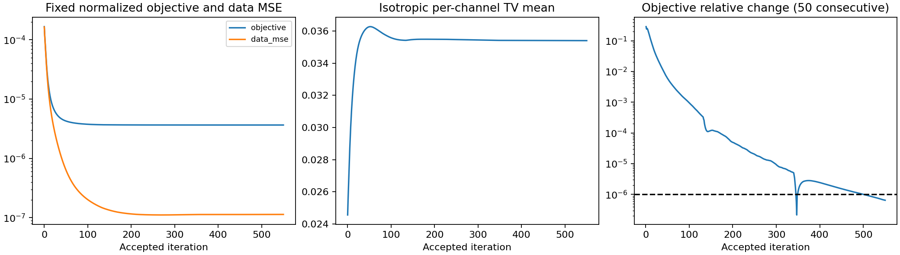
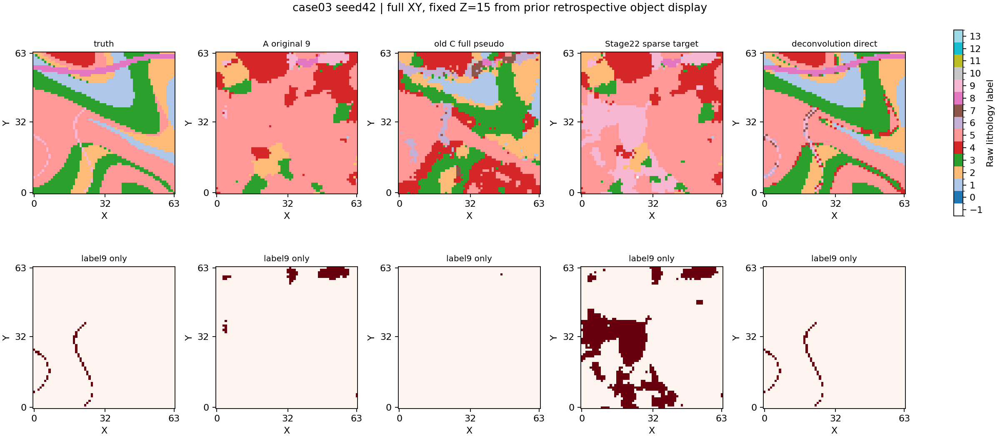

# Stage22：平滑算子感知的属性恢复与稀疏目标条件

## 结论先读

**考虑平滑算子后，确实提取出了可用目标条件；但原生Flow的稀疏目标硬条件桥接未通过本轮研究判据。** 本轮仅执行seed42一份新Flow（32次前向），按规则停止，seed142/242未执行；没有改正则、阈值、布局或条件。

1. **条件提取成功，候选误报为0。** 单次CPU求解550步收敛，得到79个新增label9体素，分布在36列；79个均为TP，FP=0，precision=1.0，其中36个位于原井/地表均零命中的572体素对象1。它们是旧512布局内的部分目标位置，不是512口新增完整井。
2. **存在直接写入之外的生成响应，但尚不是可靠对象恢复。** 对象1剔除36个新增条件后，固定536体素子集的TP由A的0增至392，覆盖率由0增至0.731343；COPY_ONLY在该子集仍为0。对象1全部572体素中有428个被预测为目标（任意预测覆盖0.748251），不能将匹配IoU=0误解为完全没有定位。
3. **一对一匹配失败来自对象合并和大量FP。** 新预测分量2在原未知域有27758体素，显著重叠两个真值对象，且包含26581个FP。旧一对一匹配把它分给对象2，对象1因此未匹配，matched IoU/coverage均为0。对象2匹配IoU也仅0.026589。原未知域目标预测31888体素，对照真值1733；TP=1177、FP=30711、FN=556，precision=0.036910、recall=0.679169、IoU=0.036278。目标召回/精度均高于A，但绝对精度仍很低，不能只报相对A的改善。
4. **Flow明显损失了前处理直接结果。** 去卷积全域最近码本分类加回原条件，在原未知域TP=1679、FP=2、FN=54，precision=0.998810、recall=0.968840、IoU=0.967723、固定类mIoU=0.662712；对象1匹配IoU=0.991289，新增条件外TP=533/536。Flow的对应IoU/mIoU只有0.036278/0.106147。前处理分类只在这个理想属性代理中接近目标真值，不等于所有岩性都已精确恢复。
5. **按seed42研究门槛停止。** 原未知域recall和precision优于A这一项通过；对象1的一对一IoU/coverage未达到0.10；holdout mIoU从A的0.148135降至0.131576，降幅0.016559超过容许0.01（最低要求0.138135）。因此不得补seed142/242，未测试结果不被推断。

**下一决策：停止继续加密或重复当前“少量目标硬投影→原生Flow”配置，将后续研究决策放在条件接口。** 本轮表明，在已知核、无额外噪声、人工强目标对比的已见case03上，去卷积已能恢复有用属性与目标线索；冻结Flow能响应正确稀疏正条件，却伴随过度扩张、合并和其他类别损伤。现有对照不能单独区分正负条件失衡、部分井mask分布与其他接口因素的因果贡献，也不能据此要求重训、保证软约束有效或宣称真实物理反演成功。本任务不实施后续路线。

|原未知域 seed42|precision|recall|目标IoU|固定类mIoU|对象1新增条件外TP/536|
|---|---:|---:|---:|---:|---:|
|原A|0.008743|0.023081|0.006382|0.119229|0|
|去卷积直接分类|0.998810|0.968840|0.967723|0.662712|533|
|COPY_ONLY|0.025150|0.067513|0.018666|0.120629|0|
|Stage22 Flow|0.036910|0.679169|0.036278|0.106147|392|

以下保留完整流程、原有参考及全部对象评价。上述解释未修改已冻结方法、最终迭代、候选条件或预测。

本轮停止位置：`seed42_research_gate_failed_no_confirmation`。新增Flow输出 **1份**，网络前向32次；训练、adapter、真实物理正反演及参数扫描均未运行。只使用已见case03，source seeds是同案例随机实现，不是独立地质案例。

## 目标条件是否可用

最终恢复场经固定码本与三个固定几何筛选条件，在旧512列布局内新增 **79个label9体素**，分布于 **36列**。TP=79，FP=0，precision=1.000000；原M9零命中572体素对象1内正确新增36个。所有FP保留，无真值剔除或补足井数。这是部分目标位置，不是512口完整新增井。

离线开发停止门槛（precision≥0.95且对象1正确条件≥5）：**True**；求解器收敛标记：True。空新增集precision=NA、不通过。该真值门槛在条件封存后仅决定是否停止整个实验，不是部署筛选器或独立TEST证明。

## 方法冻结与数值求解

方法冻结时间：2026-10-16T12:53:28.611833+00:00；最终场及条件封存：2026-10-16T12:54:08.234164+00:00；首次完整真值评价：2026-10-16T12:56:12.670620+00:00。各阶段hash见METHOD_FREEZE与PREPROCESSING_RECEIPT；未根据真值选择迭代快照。

目标为 mean((G(z)−y)²)+1e−4·TVmean(z)。TV采用每体素/通道三维前向差分L2范数的平均，体积外差分0，以sqrt(sum(diff²)+1e−8)平滑。G保留旧sigma1/radius3的float32核系数，CPU float64提升算术，separable replicate边界，用自动微分获得正确伴随。与原FP32算子和边界方向导数的小检查通过。

采用投影加速梯度：majorization回溯确定数值步长，目标上升时从上次接受迭代重启；不搜索科研正则参数。原条件的未平滑查表属性固定在z中，完整含空气码本界限投影。初始化为有界观测并投影原条件。最终仅使用最后接受迭代。

迭代550次；objective 0.000166326 → 3.65432481e-06；final data MSE=1.13648481e-07，TVmean=0.0354067633，约束误差=0.0，边界误差=0.0。耗时39.52s。

## 直接前处理、生成与原有参考

恢复属性乘回固定尺度，再用原raw0…13候选、权重、非空气范围和argmin。新增点还须d9≤0.01及margin≥0.05；它们是几何筛选，不是校准置信度。新增只标9、其余未知，原井/地表优先，固定holdout不写入。

RESTORED_CLASSIFICATION为恢复场全域最近码本结果加回原条件；COPY_ONLY只在原A写入本轮条件，没有网络前向，holdout逐元素等于A。B512是完整准确密集条件参考，新方案与旧C信息量/掩膜/标签类型不同，不能单独分离去卷积或条件数量的因果贡献。

|臂|seed|域|TP|FP|FN|precision|recall|IoU|固定类mIoU|对象1新增条件外TP/真值数|
|---|---:|---|---:|---:|---:|---:|---:|---:|---:|---|
|RESTORED_CLASSIFICATION|—|E_holdout|101|0|2|1.000000|0.980583|0.980583|0.746128|25/25|
|RESTORED_CLASSIFICATION|—|E_original_free|1679|2|54|0.998810|0.968840|0.967723|0.662712|533/536|
|SMOOTH_CLASSIFICATION_P|—|E_holdout|0|0|103|NA|0.000000|0.000000|0.274543|0/25|
|SMOOTH_CLASSIFICATION_P|—|E_original_free|0|0|1733|NA|0.000000|0.000000|0.248198|0/536|
|A_9|42|E_holdout|3|269|100|0.011029|0.029126|0.008065|0.148135|0/25|
|A_9|42|E_original_free|40|4535|1693|0.008743|0.023081|0.006382|0.119229|0/536|
|B_512|42|E_holdout|28|96|75|0.225806|0.271845|0.140704|0.528923|2/25|
|B_512|42|E_original_free|542|1634|1191|0.249081|0.312752|0.160974|0.492050|106/536|
|C_512|42|E_holdout|3|33|100|0.083333|0.029126|0.022059|0.288156|0/25|
|C_512|42|E_original_free|23|365|1710|0.059278|0.013272|0.010963|0.242216|0/536|
|COPY_ONLY_STAGE22|42|E_holdout|3|269|100|0.011029|0.029126|0.008065|0.148135|0/25|
|COPY_ONLY_STAGE22|42|E_original_free|117|4535|1616|0.025150|0.067513|0.018666|0.120629|0/536|
|FLOW_STAGE22|42|E_holdout|80|1933|23|0.039742|0.776699|0.039293|0.131576|25/25|
|FLOW_STAGE22|42|E_original_free|1177|30711|556|0.036910|0.679169|0.036278|0.106147|392/536|

## 隐藏对象及直接写入之外的响应

所有对象在完整真值和预测上先建立26连通ID，再在固定域一对一最大IoU匹配；原ID、连续coverage和原重叠诊断阈值保留。以下主域包括全部对象；完整两域表与预测对象表另存。对象1新增条件之外的TP在A和新结果的同一个子集上计算，不按各自mask改分母。

|臂|seed|对象ID|完整体素|匹配IoU|coverage|正确新增条件数|
|---|---:|---:|---:|---:|---:|---:|
|RESTORED_CLASSIFICATION|—|1|572|0.991289|0.994755|36|
|RESTORED_CLASSIFICATION|—|2|1164|0.944875|0.944875|43|
|SMOOTH_CLASSIFICATION_P|—|1|572|0.000000|0.000000|36|
|SMOOTH_CLASSIFICATION_P|—|2|1164|0.000000|0.000000|43|
|A_9|42|1|572|0.000000|0.000000|36|
|A_9|42|2|1164|0.029155|0.034453|43|
|B_512|42|1|572|0.070381|0.083916|36|
|B_512|42|2|1164|0.089659|0.140396|43|
|C_512|42|1|572|0.000000|0.000000|36|
|C_512|42|2|1164|0.019071|0.019811|43|
|COPY_ONLY_STAGE22|42|1|572|0.012238|0.012238|36|
|COPY_ONLY_STAGE22|42|2|1164|0.031341|0.037037|43|
|FLOW_STAGE22|42|1|572|0.000000|0.000000|36|
|FLOW_STAGE22|42|2|1164|0.026589|0.645134|43|

seed42预定判据：{'seed': 42, 'recall_improves': True, 'precision_not_worse': True, 'object1_matched_iou': False, 'object1_matched_coverage': False, 'holdout_miou_guard': False, 'passed': False, 'outside_added_object1_TP_delta': 392}。

seed42：Flow−前处理直接分类的主域目标IoU差=-0.931445、固定类mIoU差=-0.556565。对象1在新增条件之外相对A的TP变化=+392；该共同子集覆盖率变化=+0.731343。

该开发案例三seed配对重复支持：False；全部已运行seed的对象1新增条件之外TP都增加：True。研究判据通过不替代直接写入以外的生成收益检查，也不以中位数掩盖失败seed。

## 下一研究决策与限制

本轮未建立完整的配对重复生成补全支持。按停止规则收束，依据前处理精度、直接分类与生成之间的差距，另行决定是否修改条件接口或停止这一固定路线；不自动降低阈值、换TV系数或增加伪井。

使用已知Gaussian核、无额外噪声、人工强目标对比及已见case03；成功只是理想代理下可行，失败也不否定所有去卷积或空间反演。TV系数1e−4是事先工作假设，没有最优性或文献成功保证。

方法背景：[TV去卷积](https://www.ipol.im/pub/art/2012/g-tvdc/)、[投影/加速近端梯度的FISTA基础](https://doi.org/10.1137/080716542)、[物性与地质联合约束背景](https://academic.oup.com/gji/article/219/3/1989/5556947)。本轮并非Split Bregman或PGI复现，不声称方法创新。

执行命令、测试结果、源代码和输入身份见README、TEST_RESULTS、METHOD_FREEZE、inference_registry及source_snapshot。PREPROCESSING_RECEIPT先于完整真值评价；预测receipt记录实际A噪声指针/hash、EMA/embedding、模型不变、条件违例和前向数。
