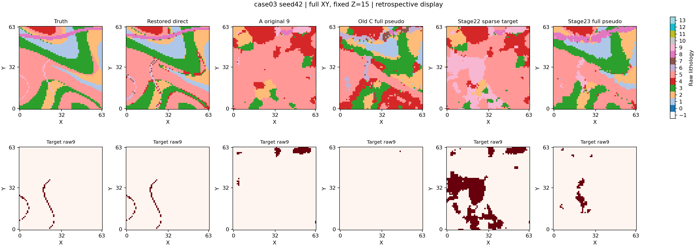

# Stage23：恢复属性 → 完整多岩性伪井 → 冻结 Flow

## 复核结论：三个层次分别判断

1. **转换改善：支持，且目标与其他类均改善。** 同一18,555个新增条件位置，全岩性错误7239→1402（准确率60.9863%→92.4441%），真非目标错分7028→1395；目标FN211→7、TP0→204，但引入1个目标FP（precision99.5122%、recall96.6825%）。保留全部错误，未按真值修井。
2. **建模收益：支持本次预定的单样本比较，但恢复仍不完整。** 对旧C，holdout recall0.029126→0.339806、IoU0.022059→0.130112、固定类mIoU0.288156→0.503877；对象1共同510个井外体素上TP为144（28.2353%），A/COPY均0，旧C也0。对象1不是仅靠直接写入出现，但仅任意覆盖206/572（36.0140%），匹配覆盖112/572（19.5804%）、IoU0.122137，仍有碎裂；对象2任意覆盖509/1161（43.8415%）、匹配IoU0.158041。没有多seed支持。
3. **范围控制：相对Stage22明显改善，绝对质量仍不足。** 原未知域precision3.6910%→21.7061%、FP30711→2579、预测/真值体积31888/1733→3294/1733（18.4005倍→1.90075倍，仍高估90.0750%）；跨两真对象的显著合并分量1→0。最大的预测分量从27758体素/26581FP/重叠2对象，降为2173体素/1718FP/重叠1对象。但对象1显著重叠3个预测分量，仍分裂；共同井外覆盖反而低于Stage22的366/510，范围收敛伴随召回损失，不能说全面优于Stage22。

新Flow原未知域TP715/FP2579/FN1018、IoU0.165816、mIoU0.454242。准确真井B512原未知域IoU0.160974、mIoU0.492050；新Flow目标IoU略高，但全类更差，holdout IoU也低于B的0.140704。恢复场直接分类原未知域IoU0.967723、mIoU0.662712，新Flow明显退化；其对象1共同井外TP507/510，远高于本轮144/510。A/B/C/direct的完整绝对差值见下表。结果只支持“完整伪井能改善这一次的井外目标恢复和范围控制”，不能宣称已获得准确几何。

工程记录：v1依赖导入失败，0前向；v2已完成32前向后，相对路径导致收据序列化失败，CPU核验保存张量/轨迹后恢复封存，未重跑采样。原失败收据保存在predictions/seed42/failed_save_receipt.json，恢复脚本为RECOVER_SAVED_OUTPUT.py。before/after模型相等依据是保存失败前已执行通过的运行时断言，恢复收据明确注明证据来源；耗时根据trace文件时间近似重建。最终入口已修复路径resolve并增加回归测试，5项CPU检查通过；正式执行版本与交付版本差异见POST_RUN_CODE_FIX，未改科学方法。

本轮已完成并停止：只使用已见 fullgeo_case03、源 seed42、旧总井布局512；新增1份Flow预测、实际32次速度前向。没有训练、新去卷积、参数扫描、后处理修剪或其他seed/case。

初始提交 `8ac499a2b5fc0cacf205066f92b382625c314da4`，工作区状态见 METHOD_FREEZE。旧实验、旧stage21v2/stage22源码与模型保持只读；未commit/push。

与Stage22相比，本轮取消 pred==9、d9≤0.01、margin≥0.05 的目标专用筛选，在原512总井布局的全部非原条件深度写入恢复分类。新增18555体素、503列；512含原9井，不是新增512井。背景及所有其他预测岩性均保留，原井/地表（含硬空气）优先，mask外为−1。新mask逐元素等于旧B512/C512；holdout新增0。

直接复用R22 classification张量，CPU一次重算仅核对原FP32分类一致性，未求解恢复场。码本、双通道权重、非空气max-min范围、raw0…13候选与argmin并列规则不变。候选不含空气，未用真值空气mask修正新增井。

方法冻结 2026-10-16T16:32:20.763088+00:00；条件封存 2026-10-16T16:32:20.870456+00:00；Flow开始 2026-10-16T16:32:39.173781+00:00、完成 2026-10-16T16:34:10.179081+00:00；首次完整真值评价 2026-10-16T16:34:20.703400+00:00。准备与推理有文件读取防火墙；封存前未读取完整真值/对象/q9，科学精度不用于决定是否运行。

推理复用原sample_native与32步中点时间Euler，411个EMA权重及原checkpoint冻结embedding，全部参数冻结、FP32无autocast/TF32。实际A噪声tensor SHA256 `6c4f6450e0e2eb2103d190b9747a1af6bc8e806c00a973a54511ea7bdd1ae81d`；模型before/after等于旧A `10d2181fe3eeeb406afc3da5e78ded64e9f92abfb2b3c352ee57e60e06da9b68`。原条件/新增条件违例均0。含加载近似耗时22.61s。

工程重试已保留：v1防火墙误拦截Python依赖sympy.geometry，模型初始化前失败、前向0次、无预测。仅把geometry限制收窄为experiments内资产；v1日志/receipt/源码快照不覆盖，v2重新封存相同科学条件。合计仍是1份新Flow、32前向。

## 1. 转换改善（只在相同 added_mask 上）

|标签来源|体素数|错误数|准确率|真目标错分/FN|真非目标错分|目标TP|目标FP|目标precision|目标recall|目标IoU|
|---|---:|---:|---:|---:|---:|---:|---:|---:|---:|---:|
|C_512|18555|7239|0.609863|211|7028|0|0|NA|0.000000|0.000000|
|STAGE23_WELLS|18555|1402|0.924441|7|1395|204|1|0.995122|0.966825|0.962264|

本轮−旧C：全岩性错误 -5837，真目标漏失 -204，真非目标错分 -5633；目标FP +1。该域真空气体素数0，全部保留；未依据真值删除坏井。

两份confusion CSV的行是真值、列是预测，包含raw−1…13；condition_class_metrics.csv给出每类TP/FP/FN、P/R/IoU。不能将新增条件位置的正确率当作井外生成精度。

## 2. 建模收益（两个固定域及共同井外对象子集）

E_holdout与E_original_free及各自类别集合完全沿用R21。后者保留新增伪井体素，未扣除新条件后冒用原域名称。holdout未直接写入条件，但其信息参与全局属性代理，不能称为独立观测留出或未知地质TEST。

|臂|域|TP|FP|FN|precision|recall|IoU|固定类mIoU|预测/真值体积|体积比|
|---|---|---:|---:|---:|---:|---:|---:|---:|---|---:|
|A_9|E_holdout|3|269|100|0.011029|0.029126|0.008065|0.148135|272/103|2.640777|
|A_9|E_original_free|40|4535|1693|0.008743|0.023081|0.006382|0.119229|4575/1733|2.639931|
|B_512|E_holdout|28|96|75|0.225806|0.271845|0.140704|0.528923|124/103|1.203883|
|B_512|E_original_free|542|1634|1191|0.249081|0.312752|0.160974|0.492050|2176/1733|1.255626|
|C_512|E_holdout|3|33|100|0.083333|0.029126|0.022059|0.288156|36/103|0.349515|
|C_512|E_original_free|23|365|1710|0.059278|0.013272|0.010963|0.242216|388/1733|0.223889|
|FLOW_STAGE22|E_holdout|80|1933|23|0.039742|0.776699|0.039293|0.131576|2013/103|19.543689|
|FLOW_STAGE22|E_original_free|1177|30711|556|0.036910|0.679169|0.036278|0.106147|31888/1733|18.400462|
|RESTORED_CLASSIFICATION|E_holdout|101|0|2|1.000000|0.980583|0.980583|0.746128|101/103|0.980583|
|RESTORED_CLASSIFICATION|E_original_free|1679|2|54|0.998810|0.968840|0.967723|0.662712|1681/1733|0.969994|
|COPY_ONLY_STAGE23|E_holdout|3|269|100|0.011029|0.029126|0.008065|0.148135|272/103|2.640777|
|COPY_ONLY_STAGE23|E_original_free|242|3977|1491|0.057360|0.139642|0.042382|0.170149|4219/1733|2.434507|
|FLOW_STAGE23|E_holdout|35|166|68|0.174129|0.339806|0.130112|0.503877|201/103|1.951456|
|FLOW_STAGE23|E_original_free|715|2579|1018|0.217061|0.412579|0.165816|0.454242|3294/1733|1.900750|

所有旧Flow和恢复场直接结果均复用保存资产；只有COPY_ONLY在旧A上写入本轮条件，无网络，holdout与A逐元素相同。B512为同mask准确真井参考，直接恢复分类使用全空间信息；它们不是等信息预算的竞争臂。Stage22仅稀疏正类，其mask不同，本轮比较是完整流水线诊断，不能分离各因素因果作用。

对象1完整572体素，原井/地表零命中。共同子集固定为 truthID1 ∩ E_original_free ∩ ~Stage23_new_mask，分母510；所有臂使用同一子集：

|臂|共同井外TP|共同分母|覆盖率|
|---|---:|---:|---:|
|A_9|0|510|0.000000|
|B_512|80|510|0.156863|
|C_512|0|510|0.000000|
|FLOW_STAGE22|366|510|0.717647|
|RESTORED_CLASSIFICATION|507|510|0.994118|
|COPY_ONLY_STAGE23|0|510|0.000000|
|FLOW_STAGE23|144|510|0.282353|

预定建模判断逐项：`{'holdout_recall_improves': True, 'holdout_iou_improves': True, 'holdout_miou_maintained': True, 'object1_outside_tp_above_A': True, 'object1_outside_tp_above_COPY': True}`。全部满足：**True**。若有指标冲突，只能解释为部分收益。对象1井外TP相对A/COPY分别变化+144/+144。

## 3. 范围控制与对象匹配

完整体积先做26连通ID，再按固定域进行旧一对一最大IoU匹配和merge/split判定。下表保留两个真值对象；匹配0不等于任意预测覆盖0。高覆盖也不能抵消巨大FP。两域完整结果见object_metrics.csv。

|臂|真对象ID|完整体素|匹配IoU|匹配覆盖|任意预测覆盖|
|---|---:|---:|---:|---:|---:|
|A_9|1|572|0.000000|0.000000|0.000000|
|A_9|2|1164|0.029155|0.034453|0.034453|
|B_512|1|572|0.070381|0.083916|0.248252|
|B_512|2|1164|0.089659|0.140396|0.344531|
|C_512|1|572|0.000000|0.000000|0.000000|
|C_512|2|1164|0.019071|0.019811|0.019811|
|FLOW_STAGE22|1|572|0.000000|0.000000|0.748252|
|FLOW_STAGE22|2|1164|0.026589|0.645134|0.645134|
|RESTORED_CLASSIFICATION|1|572|0.991289|0.994755|0.994755|
|RESTORED_CLASSIFICATION|2|1164|0.944875|0.944875|0.956072|
|COPY_ONLY_STAGE23|1|572|0.015734|0.015734|0.108392|
|COPY_ONLY_STAGE23|2|1164|0.034866|0.040482|0.155039|
|FLOW_STAGE23|1|572|0.122137|0.195804|0.360140|
|FLOW_STAGE23|2|1164|0.158041|0.391904|0.438415|

主要预测分量（每臂取原未知域体积最大的3个；全部分量保存在predicted_object_metrics.csv）：

|臂|分量ID|完整体积|原未知域体积|原未知域FP|显著重叠真对象数|
|---|---:|---:|---:|---:|---:|
|A_9|18|3150|3150|3150|0|
|A_9|3|492|492|492|0|
|A_9|13|254|251|211|0|
|B_512|13|820|820|657|1|
|B_512|19|368|368|280|1|
|B_512|16|231|231|174|0|
|C_512|17|84|84|84|0|
|C_512|11|71|68|45|0|
|C_512|21|53|53|53|0|
|FLOW_STAGE22|2|27761|27758|26581|2|
|FLOW_STAGE22|11|3698|3698|3698|0|
|FLOW_STAGE22|4|331|331|331|0|
|RESTORED_CLASSIFICATION|2|1100|1097|0|1|
|RESTORED_CLASSIFICATION|1|571|571|2|1|
|RESTORED_CLASSIFICATION|3|13|13|0|0|
|COPY_ONLY_STAGE23|73|2754|2754|2754|0|
|COPY_ONLY_STAGE23|4|424|424|424|0|
|COPY_ONLY_STAGE23|50|237|234|187|0|
|FLOW_STAGE23|13|2176|2173|1718|1|
|FLOW_STAGE23|3|457|457|345|1|
|FLOW_STAGE23|1|217|217|160|1|

相比Stage22，原未知域precision 0.036910 → 0.217061；绝对相对体积误差 17.400462 → 0.900750；合并分量数 1 → 0；分裂真对象数 0 → 1。是否绝对可接受须结合上述FP、体积与对象结果，不能仅凭优于Stage22判成功。

本轮−参考的原未知域差值：

|参考|Δprecision|Δrecall|ΔIoU|ΔmIoU|ΔFP|Δ体积比|
|---|---:|---:|---:|---:|---:|---:|
|A_9|+0.208318|+0.389498|+0.159435|+0.335013|-1956|-0.739181|
|B_512|-0.032020|+0.099827|+0.004842|-0.037809|+945|+0.645124|
|C_512|+0.157783|+0.399308|+0.154854|+0.212026|+2214|+1.676861|
|FLOW_STAGE22|+0.180151|-0.266590|+0.129538|+0.348094|-28132|-16.499711|
|RESTORED_CLASSIFICATION|-0.781749|-0.556261|-0.801907|-0.208471|+2577|+0.930756|

图为沿用此前对象展示的Z=15全64×64 XY截面，统一raw−1…13色标；第二行为统一目标二值色标。未为本轮结果重新搜索截面。

已达到本轮唯一预测预算，立即停止。三层判断分别据转换错误、井外生成收益、误报/范围控制讨论，不合并成单一宽松“通过”。仍需区分属性转换质量与冻结Flow几何质量；本轮没有多seed重复支持。

仅为已知核、无额外噪声、人工属性对比、已见案例的路线诊断；不证明真实地球物理反演、跨模型泛化或论文创新性。后续由用户与MCYR决定，本轮不追加实验。

交付：PROTOCOL / METHOD_FREEZE / CONDITION_RECEIPT / inference_registry保存方法、输入、代码与条件身份；COMMANDS和TEST_RESULTS记录命令与必要检查；EXECUTION保存预算；sample_metrics.csv、class_metrics.csv、condition_quality.csv、两份confusion CSV、对象表和本图保存评价；predictions/seed42/decoded_geology.pt及receipt保存唯一新Flow。
